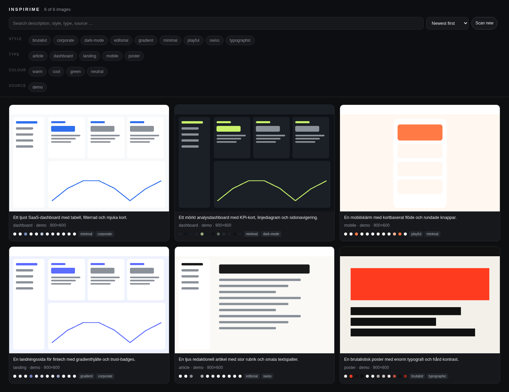
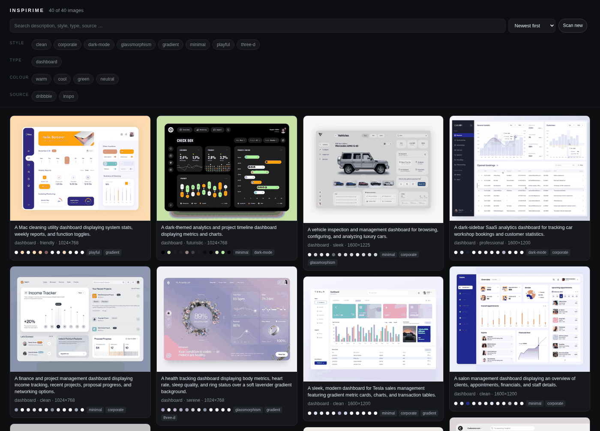

# Inspirime

**Your saved design screenshots, turned into a library a design agent can actually read.**

Drop in a folder of Pinterest/Dribbble saves. Inspirime measures the colours from the pixels,
has a vision model read the layout, and gives every reference a dense, unambiguous design brief —
then serves it to Hermes, Claude Code, Cursor or any MCP client, with the image attached.



*That is `inspirime demo` — six drawn samples, no API key, no screenshots of anyone else's work.*



*A real library, 40 saved Pinterest/Dribbble screenshots, same header and filters. The references
stay the property of their creators; Inspirime only indexes and measures them.*

## Why

A screenshot folder is a graveyard: you remember "that dark dashboard with the lime accent" and then
scroll for five minutes. And when you finally want to *build* something in that style, you hand an
agent a picture and a vague sentence.

Inspirime does two things about that:

1. **Measures instead of guessing.** Palette (12 colours, each with the share of the image it
   covers), background, accent, text colour behind a WCAG contrast gate — all read from the pixels.
   The model only does what models are good at: layout, sections, typography, density.
2. **Writes the brief, not just a tag.** One reference becomes a sectioned brief: goal, reference
   facts, exact hex values, numbered requirements, prohibitions, delivery format, and a checklist
   the agent verifies itself against. Swedish or English (`INSPIRIME_LANG`).

## Install

```bash
pipx install git+https://github.com/<you>/inspirime      # or: pip install --user .
inspirime demo                                          # sample library, no key needed
inspirime open                                          # gallery at http://127.0.0.1:8789
```

Python 3.9+, one dependency (Pillow), no server to deploy, no database to install — SQLite, one file.

## Use

```bash
inspirime scan ~/Pictures/inspo            # index a folder (copies into library/, originals untouched)
inspirime scan                             # or drop files in inbox/pinterest, inbox/dribbble
inspirime open                             # browse, filter, click a card → brief → send
inspirime brief <key>                      # the brief, in the terminal
inspirime export --out library.json        # the whole index as JSON
inspirime tag <key> +minimal -corporate    # correct the model by hand
inspirime delete <key>                     # remove one reference
```

The gallery has a **Scan new** button (needs `inspirime open`, not `file://`), filters for style,
type, colour family and source, and sorting by colour or type.

## Give it to your agent

`inspirime mcp` is a stdio MCP server — no port, no daemon, no dependencies:

| tool | what it does |
|---|---|
| `handoffs` | references you pressed **Send** on in the gallery, newest first |
| `search` | free text + type/style/colour/source over the whole library |
| `get` | the full record, the brief, **and the image as an attachment** |
| `ack` | marks a handoff as taken |

```bash
hermes mcp add inspirime --command python3 --args /path/to/inspirime.py mcp
claude mcp add inspirime python3 /path/to/inspirime.py mcp
codex  mcp add inspirime -- python3 /path/to/inspirime.py mcp
```

**Send** in the gallery freezes the brief into a queue and copies it to the clipboard, so nothing is
lost when no agent is running: the entry waits, and `get` works on any key later.

## The model

Any of these works. With none configured, Inspirime still indexes and measures — descriptions just
stay empty until you add a key.

| setup | how |
|---|---|
| Google Gemini | `GEMINI_API_KEY=...` in `./.env` (default) |
| OpenAI | `OPENAI_API_KEY=...` |
| Anything OpenAI-compatible (LM Studio, Ollama, vLLM, a router) | `INSPIRIME_VISION_URL=http://host:port/v1` + `INSPIRIME_VISION_MODEL` |

Gemini Flash costs a fraction of a cent per image. Undescribed rows are retried on the next `scan`,
so a run is always safe to repeat. Images go only to the provider you configure.

## Files

```
inspirime.py        the whole tool (one file)
inbox/<source>/     where you drop screenshots; the folder name becomes the source filter
library/            copies of indexed images
inspirime.db        SQLite index + the handoff queue
gallery.html        generated gallery
```

Set `INSPIRIME_HOME` to keep that data elsewhere (an installed copy defaults to
`~/.local/share/inspirime`).

## Tests

```bash
python3 tests/test_inspirime.py     # 12 checks, no network, no API key
inspirime selfcheck                 # the same logic, shipped with the tool
```

## Notes and limits

- Colour, size, ratio and contrast are **measured**; layout, sections and typography are a model's
  reading of the picture — a good draft, correctable with `inspirime tag`.
- No accent means no accent: on a monochrome reference the brief says so instead of inventing a hex.
- The local server binds to `127.0.0.1` and serves only the library folder.
- MIT licensed.

Svensk dokumentation: [docs/svenska.md](docs/svenska.md).
